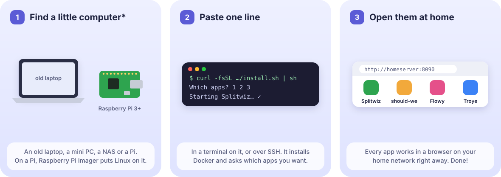
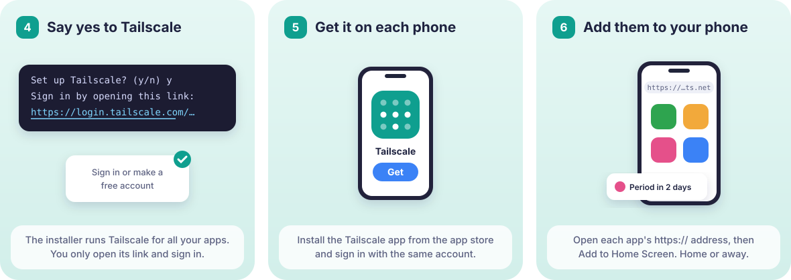

# Install selfhostit apps

selfhostit apps are small apps you run on your own hardware: a Raspberry Pi, a NAS or a
cheap server. Each one is a single container with its data in one folder, and they all
install the same way, with Docker.

| App | What it does | Port |
|---|---|---|
| [Splitwiz](https://github.com/selfhostit/splitwiz) | Split shared costs with your partner or roommate | 8090 |
| [should-we](https://github.com/selfhostit/should-we) | Pick one option together, as a group | 8091 |
| [Flowy](https://github.com/selfhostit/flowy) | A private period and cycle tracker | 8092 |
| [Troye](https://github.com/selfhostit/troye) | A private calorie and weight tracker | 8093 |
| [Shoppa](https://github.com/selfhostit/shoppa) | A shared shopping list for your household | 8094 |
| [Calio](https://github.com/selfhostit/calio) | One calendar for your household: plans, pet sitting and trips | 8095 |

The port is where the installer puts each app, so they can all run on one machine. If
another program already has it, the app gets the next free port, and keeps that one.

## Quick start

**1. Install the apps you want.** You need a little computer that runs Linux, such as an old
laptop, a mini PC, a Raspberry Pi or a NAS (see [what you need](#what-you-need)), and a
terminal on it, or SSH. Then:

```sh
curl -fsSL https://github.com/selfhostit/docs/releases/latest/download/install.sh | sh
```



The installer sets up Docker if it is missing (on Linux), shows the apps and asks which ones
you want: one, a few or all of them. Each app runs on its own and needs none of the others,
so start with the one you came for and add more later the same way. To skip the menu, put
the app names at the end:

```sh
curl -fsSL https://github.com/selfhostit/docs/releases/latest/download/install.sh | sh -s -- flowy
```

It then asks where to keep them and starts them. Run the same line again to update; your
settings and data are kept. Step by step: [a Pi or Linux](linux.md), a
[Synology](synology.md) or [another NAS](other-nas.md).

**2. Open an app and make your account.** At the end the installer lists each app's address
and a one-time setup code. Open the address, type the code and create your account: you
become the app's owner. [After you install](first-steps.md) says how to add the rest of your
household, and what to do when something doesn't open.

**3. Open them from your phones and other computers.** The apps only answer on the machine
they run on, so nothing else on your network or the internet can reach them by accident. To
use them from your phone or laptop, at home and away, they need an `https://` address, which
phones also need to install a web app and show its notifications. The installer can give all
your apps one with [Tailscale](phones.md#tailscale-recommended), a free private network that
only your own devices can reach: say yes when it asks. There is nothing to install on the
server, because the installer runs Tailscale for you; you sign in once, and each phone gets
the Tailscale app. Then [put the apps on your phones](phones.md#install-the-app-on-the-phone).



Already have a domain? Use [a reverse proxy](phones.md#your-own-domain-with-a-reverse-proxy)
instead of Tailscale.

Prefer to read and check a script before you run it? Download it, verify it, read it, then
run it:

```sh
curl -fsSLO https://github.com/selfhostit/docs/releases/latest/download/install.sh
gh attestation verify install.sh --repo selfhostit/docs
less install.sh
sh install.sh
```

The installer is a signed release, and it installs a pinned release of each app, checking
every file it downloads against its SHA-256.

[Security and privacy](security.md) says step by step what it does, what the apps protect
and what you are trusting.

## Security in short

The apps keep their data on your machine, in one folder each, with no selfhostit cloud and no
analytics. They listen on `127.0.0.1` only and are reached through Tailscale or your own
reverse proxy, never a forwarded port. Containers run as a normal user with no Linux
capabilities and a read-only filesystem, a new install asks for a one-time setup code,
passwords are stored as bcrypt hashes, sign-ins are rate limited and the web apps send a
Content Security Policy. Every change, and every week, is scanned with CodeQL, govulncheck,
Grype and gitleaks. Updates follow versioned releases, each image has a signed attestation
of the commit that built it, and the installer pins each app's release with SHA-256 checks.
Not done yet: an independent audit.
Details, with links to the code: [Security and privacy](security.md). Report a problem
privately through the app's Security tab on GitHub or to kalfasyan@pm.me
([policy](https://github.com/selfhostit/.github/blob/main/SECURITY.md)).

## Guides

- [Raspberry Pi and Linux](linux.md): a Pi, a mini PC, an old laptop or a VPS.
- [Synology NAS](synology.md): with Container Manager, from the DSM web interface.
- [Other NAS and home servers](other-nas.md): QNAP, Unraid, TrueNAS SCALE, Portainer,
  CasaOS and anything else that takes a Compose file.
- [Use them on your phones](phones.md): Tailscale, or a reverse proxy with your own domain.
- [After you install](first-steps.md): your first account, adding your household, and what to
  do when an app doesn't open.
- [Updates and backups](updates-and-backups.md)
- [Security and privacy](security.md): how your data is protected, and how to report a problem.

## What you need

Anything that runs Docker containers for `linux/amd64`, `linux/arm64` or `linux/arm/v7`:
x86 and ARM servers, a Raspberry Pi 3 or newer (64-bit Raspberry Pi OS is best), and NAS
models with a Docker app. Each app needs about 128 to 512 MB of memory. NAS models without
Docker support (many budget and older ones) won't work.

## Questions or ideas?

Need a hand with setup, or have an idea for an app? Write to kalfasyan@pm.me, or see [selfhostit.org/contact](https://selfhostit.org/contact.html).
Found a bug in an app? Open an issue in that app's repository.
